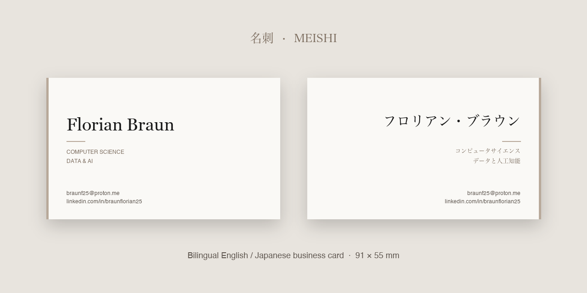

# 名刺 · Meishi



A bilingual (English / Japanese) business card, designed entirely in HTML and CSS and ready to print at the standard Japanese *meishi* size of **91 × 55 mm**.

- **Front:** English — name, field of study and contact details
- **Back:** 日本語 — the same information in Japanese
- Single self-contained file, no build step, no dependencies (only the Noto Serif JP web font)

## Preview

**Live:** https://meishi.braunf.com/

Open [`index.html`](index.html) in any modern browser, or serve it locally:

```bash
python3 -m http.server 8000   # then visit http://localhost:8000
```

## Printing

1. Open `index.html` and click **Print cards** (or press <kbd>Ctrl/Cmd</kbd>+<kbd>P</kbd>).
2. In the print dialog, choose a custom paper size of **91 × 55 mm**, set margins to **None**, and enable **Background graphics**.
3. Each side prints on its own page: page 1 is the front, page 2 is the back.

For best results use thick uncoated stock (around 350 gsm), or export to PDF and send it to a print shop.

## Customising

All content lives in the `<body>` of `index.html`; colours and sizes are CSS variables in `:root`. Replace the name, titles and contact lines on both sides to make it your own.

## License

[MIT](LICENSE) © 2026 Florian Braun
